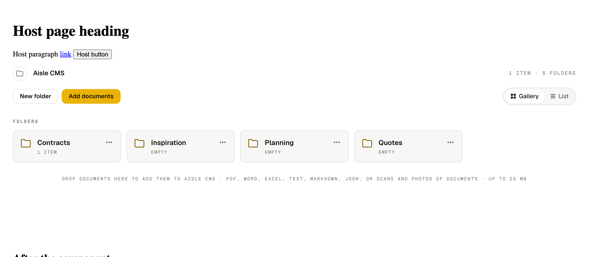
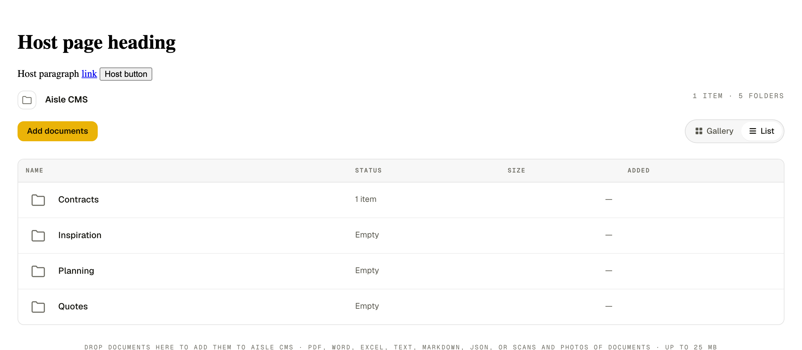
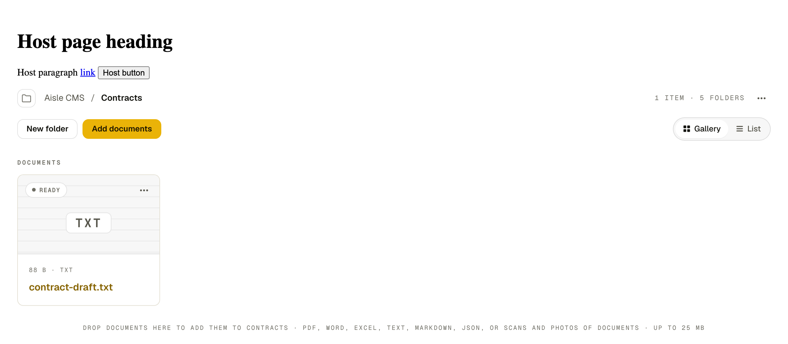
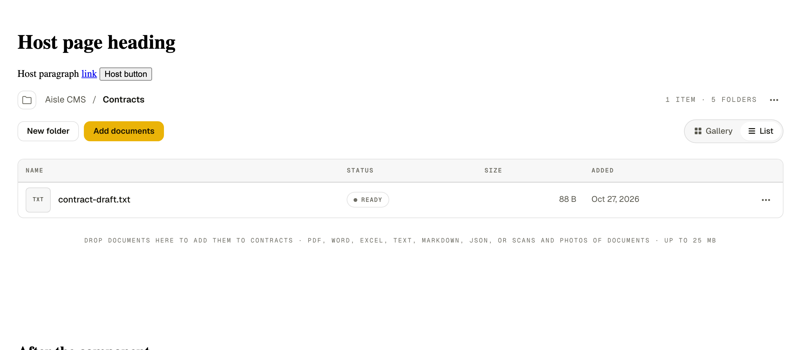

# @pj-slf-998231/sdk

Client and React UI for the Shelf folder integration API (`/api/v1/integration`).
Two parts, one package:

- A framework-free TypeScript client (`createShelfClient`).
- A React component (`<ShelfFolder>`) that renders Shelf web's own folder view, ported from its source: header with folder-tree toggle, breadcrumb and counts, Gallery/List toggle, folder cards, document cards or rows, drag-and-drop upload and the document page. It browses, opens, uploads, renames, moves and deletes the documents in one folder.

The package is private, published to GitHub Packages under the `@pj-slf-998231` scope.

## Install

Add an `.npmrc` next to your `package.json`. The token comes from the environment; never commit it.

```ini
@pj-slf-998231:registry=https://npm.pkg.github.com
//npm.pkg.github.com/:_authToken=${NODE_AUTH_TOKEN}
```

Export a GitHub token with `read:packages` (a personal access token locally, `GITHUB_TOKEN` or a PAT in CI), then install:

```sh
export NODE_AUTH_TOKEN=<token with read:packages>
npm install @pj-slf-998231/sdk
```

`react` and `react-dom` (>= 18) are optional peer dependencies, needed only for `@pj-slf-998231/sdk/react`.

## Security model

A folder key (`shelf_ik_...`) is a bearer credential for one Shelf folder, read-only or read_write.

- The key must never reach a browser: not in a bundle, not in a request, not in a cookie. Keep it in server-side configuration (for example a Fly secret).
- Browser-direct use is unsupported. Browsers talk to your own server, which authenticates the user and adds the key.
- Revoking the key in Shelf makes every call fail; the proxy then answers `503 not_configured` and the UI shows a "not configured" state instead of data (fail closed).

## Create a key

In Shelf web, open the folder, open its integrations dialog and create a key. Choose `read` or `read_write`. The key is shown once; copy it into your server's secret store (for example `SHELF_INTEGRATION_KEY`). Set `SHELF_API_URL` to your Shelf API origin.

## Client modes

### Server (with an API key)

```ts
import { createShelfClient } from '@pj-slf-998231/sdk';

const shelf = createShelfClient({
  baseUrl: `${process.env.SHELF_API_URL}/api/v1/integration`,
  apiKey: process.env.SHELF_INTEGRATION_KEY, // sent as Authorization: Bearer
});

const { items, next_cursor } = await shelf.listFiles({ limit: 50 }); // items is always an array
const file = await shelf.upload(new Blob(['hello']), { filename: 'hello.txt' });
```

Methods: `info()`, `folders()`, `listFiles({ folder_id, limit, cursor, recursive })`, `getFile(id)`, `upload(blob, { folder_id, filename, client_ref, on_duplicate })`, `updateFile(id, { filename, folder_id })`, `deleteFile(id)`, `thumbnailUrl(id, size?)`, `originalUrl(id, filename)`. Failures throw `ShelfError` with `status`, `code` and optional `field`.

### Browser (through your proxy)

```ts
const shelf = createShelfClient({ baseUrl: '/api/shelf' }); // no apiKey
```

Requests are same-origin (`credentials: 'same-origin'`), so your session cookie authenticates the user and the proxy adds the key.

## Server-side proxy recipe

Mount a proxy at `/api/shelf/*` behind your own session check. It forwards to `${SHELF_API_URL}/api/v1/integration/<path>` and adds `Authorization: Bearer ${SHELF_INTEGRATION_KEY}`.

Route table (anything else: 404, do not forward):

| Method | Path | Notes |
| --- | --- | --- |
| GET | `/` | key and folder info |
| GET | `/folders` | folders reachable by the key |
| GET | `/files?folder_id&limit&cursor&recursive` | list |
| GET | `/files/{id}` | details and text |
| GET | `/files/{id}/thumbnail?size` | image preview |
| GET | `/files/{id}/original/{name}` | download; stream the body |
| POST | `/files` | multipart: `file`, `folder_id`, `client_ref`, `on_duplicate`; stream the body |
| PATCH | `/files/{id}` | rename or move (JSON) |
| DELETE | `/files/{id}` | delete |

Header allowlist. Forward only these and drop everything else, in particular the browser's `Authorization`, `Cookie` and `Host`.

- Request to Shelf: `Content-Type` (keeps the multipart boundary), `Accept`, `If-None-Match`, `Range`.
- Response to the browser: `Content-Type`, `Content-Length`, `Content-Disposition`, `Cache-Control`, `ETag`, `Last-Modified`.

Errors the proxy produces itself:

| Condition | Response |
| --- | --- |
| No valid user session | 401 (your own auth) |
| `SHELF_INTEGRATION_KEY` unset, or Shelf answers 401 (key revoked or invalid) | `503 {"code":"not_configured"}` (fail closed) |
| Shelf unreachable or times out | 502 |
| Method or path not in the route table | 404 |
| Other Shelf errors (400, 403, 404, 409, 413, 415, 429) | pass through status and JSON body |

Minimal Express sketch:

```ts
const ROUTES: [string, RegExp][] = [
  ['GET', /^\/?$/], ['GET', /^\/folders$/], ['GET', /^\/files$/],
  ['GET', /^\/files\/[^/]+$/], ['GET', /^\/files\/[^/]+\/thumbnail$/],
  ['GET', /^\/files\/[^/]+\/original\/[^/]+$/], ['POST', /^\/files$/],
  ['PATCH', /^\/files\/[^/]+$/], ['DELETE', /^\/files\/[^/]+$/],
];

app.use('/api/shelf', requireSession, async (req, res) => {
  if (!ROUTES.some(([m, re]) => m === req.method && re.test(req.path))) return res.sendStatus(404);
  const key = process.env.SHELF_INTEGRATION_KEY;
  if (!key) return res.status(503).json({ code: 'not_configured' });
  const headers: Record<string, string> = { Authorization: `Bearer ${key}` };
  for (const h of ['content-type', 'accept', 'if-none-match', 'range']) {
    if (req.headers[h]) headers[h] = String(req.headers[h]);
  }
  let up: Response;
  try {
    up = await fetch(`${process.env.SHELF_API_URL}/api/v1/integration${req.url}`, {
      method: req.method, headers,
      body: req.method === 'POST' || req.method === 'PATCH' ? (req as any) : undefined,
      duplex: 'half',
    } as RequestInit);
  } catch {
    return res.status(502).json({ code: 'bad_gateway' });
  }
  if (up.status === 401) return res.status(503).json({ code: 'not_configured' });
  res.status(up.status);
  for (const h of ['content-type', 'content-length', 'content-disposition', 'cache-control', 'etag', 'last-modified']) {
    const v = up.headers.get(h);
    if (v) res.setHeader(h, v);
  }
  up.body ? Readable.fromWeb(up.body as any).pipe(res) : res.end();
});
```

## React usage

```tsx
import { ShelfFolder } from '@pj-slf-998231/sdk/react';
import '@pj-slf-998231/sdk/styles.css';

export function Files() {
  return <ShelfFolder baseUrl="/api/shelf" />;
}
```

Props: `baseUrl` or a ready `client`, `initialFolderId`, `theme` (`'light' | 'dark' | 'auto'`, default `'light'`; only an explicit `'auto'` follows the OS), `className`, `cacheScope` (keep data on this device, see [Local-first cache](#local-first-cache)) and `onAuthLost` (called once when the key stops working).

### What it shows

The markup, class structure, CSS, tokens and icons are ported from Shelf web (`src/pages/ShelfPage.tsx`, `src/components/shelf/*`, `src/styles/global.css`, `tokens.css`), so the embed looks like Shelf's own folder view:

- Header row: a folder-icon button that opens the folder tree, the breadcrumb (ancestors muted, current folder bold), mono meta such as `1 ITEM · 5 FOLDERS`.
- Toolbar: **Add documents** (read_write keys only) and the **Gallery | List** toggle.
- A `FOLDERS` section of folder cards, a `DOCUMENTS` section of document cards (thumbnail, status pill, name, `SIZE · TYPE`), or in List mode a table of the same.
- A drop hint, `Drop documents here to add them to <folder> · PDF, Word, ...`. Dropping files anywhere on the view uploads them (read_write only).
- Click a document for the document page: type and size, filename, Text and Preview tabs, a Details panel, Download, and a Rename / Move to / Delete menu (read_write only). Delete moves the file to the Shelf trash; it can be restored in Shelf.
- A `503 not_configured` shows a "Shelf isn't connected" state.

The Gallery/List choice is remembered in `localStorage` (`shelf-sdk.layout`), and so is whether the folder tree is open (`shelf-sdk.folderTree`). If storage is unavailable (private windows, locked-down hosts) both still toggle, they are just not remembered.

### The document page on its own

`DocumentPage` (also `DocumentTextTab`, `DocumentPreviewTab` and `DocumentContentTab`) from `@pj-slf-998231/sdk/react/document-page` draws one document without the folder view: `<DocumentPage documentId="..." client={client} />`, or inside a `ShelfProvider`. Options of the page and, where it applies, of its tabs:

| Prop | Default | |
| --- | --- | --- |
| `showPreviewSizes` | `true` | `false` hides the Small / Medium / Large / Original bar over an image preview; the image still shows, at the size it opens with (the original, as wide as its container, loaded lazily). PDFs and other previews are unaffected. Also on `DocumentPreviewTab`. |
| `documentTabs` | `['text', 'preview', 'content']` | Which tabs, in what order. A listed tab that does not apply (Content for a document without a generated site) is skipped; the page opens on the first one that is available, so `['content', 'preview', 'text']` opens a document with a site on Content and one without on Preview. Arrow keys, Home and End move between the tabs in the order shown. |
| `actions` | none | `{ rename, move, delete }` callbacks. Only the ones given appear (Rename, Move to, Delete); without them the page offers Download only. |

### What it does not show

The folder view only offers what the integration API can do. It has no route to create, rename, move or delete folders, so the **New folder** button and the folder cards' and header's `...` menus are not rendered. Bulk select and the bulk bar are not rendered either. Documents get Rename, Move to and Delete.

Folder cards and the header take their document counts from the folder listing (`item_count` / `total_item_count`) when the API sends them. Otherwise they count documents by reading every document under the key's folder once (up to 1000); over that, or if that read fails, the counts are left out rather than guessed. A document card shows `SIZE · TYPE`, plus pages or words when the API sends `parsed_meta` for the list (today only the single-document route does, so the Details panel shows them and the card does not).

### Visual parity

Rendered in Chromium (Playwright) from the built `dist/` against a fake API serving the real integration shapes, with a deliberately hostile host stylesheet (global `* { box-sizing: content-box !important }`, styled `h1`-`h3`, `button`, `a`, `li`, `svg`, a body font, `text-transform` and `letter-spacing`). With and without that stylesheet the component renders pixel-identical (at most 2 of about 2 million pixels differ), and the host's own elements compute to the same styles with and without the SDK loaded.

| Root folder, Gallery | Root folder, List |
| --- | --- |
|  |  |
| Folder with a document, Gallery | Folder with a document, List |
|  |  |

More in `docs/screenshots/`: the document page, a 900 px wide layout (`*-900.png`), the same views under hostile host CSS (`*-hostile.png`), and `target-equivalent-root-gallery.png`, the root view framed like the Shelf web screenshot it was compared with. The screenshots are not part of the npm package (`files` lists only `dist` and `README.md`).

Known differences from Shelf web's folder view, all because the integration API has no matching route or datum:

- The breadcrumb starts at the key's folder (`Aisle CMS`); web shows the shelf name before it (`Aisle CMS / Aisle CMS`), and the API does not give the shelf's name.
- No **New folder** button, and no `...` menus on folder cards or in the header: there are no folder write routes.
- Folder and header counts (`1 ITEM`, `1 ITEM · 5 FOLDERS`) come from the folder listing when the API sends counts, and are derived by reading the documents once when it does not.
- The page padding and scrollbar of Shelf web's app shell belong to the host page, not the component.

Reproduce: `cd harness && npm install && npx playwright install chromium && npm run build && npm run shoot`. The harness is dev only and is not in the package.

### Host CSS requirements

None beyond importing `@pj-slf-998231/sdk/styles.css` once. Every rule sits under `.shelf-sdk` and every class is prefixed `shelf-sdk__`, so the host's element and class rules cannot match the embed and the embed never styles the host (no `:root`, `html`, `body` or bare element selectors; `npm run check:dist` fails the build if one appears). Host rules on bare elements (`h3 { font: ... }`, `li { margin: ... }`, `svg { fill: ... }`) do reach the embed's own elements, so `base.css` resets those that matter. Give it a container with a width: it fills its parent. It uses viewport media queries (720px and below stacks the layout), like Shelf web.

Theming: tokens are CSS custom properties on `.shelf-sdk` (`--bg`, `--fg`, `--accent`, `--line`, ...). Override one on `.shelf-sdk` (or via `className`), or set `theme`. The default is `light` regardless of the visitor's OS setting, so a light-only host never shows a dark embed to dark-mode visitors (0.3.x defaulted to `auto`; pass `theme="auto"` to keep that). The embed does not read an ancestor's `data-theme` or `color-scheme`: a host with its own dark mode passes `theme` itself, for example `theme={isDark ? 'dark' : 'light'}`.

### Fonts

Shelf web uses Geist, Geist Mono and Instrument Serif, loaded from Google Fonts. The SDK instead bundles the same three (Latin subset, `woff2`) in `dist/fonts/` and declares them in `styles.css` with relative `url()`s, which bundlers (Vite, webpack, Next) resolve and emit. No request leaves for a third party and no CSP exception is needed. The families are named `Shelf Geist`, `Shelf Geist Mono` and `Shelf Instrument Serif`, so they never replace a copy the host loads; if a font file cannot load, the stack falls back to `Geist`, `Geist Mono`, `Instrument Serif` if the host has them, then system fonts.

Licences: all three are under the SIL Open Font License 1.1, which allows bundling and redistribution. The licence texts ship in `dist/fonts/` (`Geist-LICENSE.txt`, `Geist-Mono-LICENSE.txt`, `Instrument-Serif-LICENSE.txt`); the files come from the `@fontsource-variable/geist`, `@fontsource-variable/geist-mono` and `@fontsource/instrument-serif` packages (dev dependencies).

## Local-first cache

`<ShelfFolder>` shows what it already knows first and revalidates in the background (stale-while-revalidate), so a folder you have opened before appears at once and keeps working without a network.

What is cached: the key info, the folder list, each viewed folder's document listing, document details, and thumbnails (small, medium, large; revalidated with `ETag` / `If-None-Match`, so an unchanged thumbnail costs a 304). The JSON routes are never cached by the browser (`no-store`); this cache is the SDK's own.

Limits (`DEFAULT_LIMITS` in `src/internal/contracts.ts`; least recently used is evicted first):

| Limit | Value |
| --- | --- |
| Thumbnails in total | 25 MiB |
| One thumbnail | 2 MiB |
| Everything (entries and thumbnails) | 50 MiB |
| One JSON entry | 1.5 MiB (over that a document's text is dropped first, then the entry is not stored) |
| Age | 30 days |

**`cacheScope` and why the default is memory-only.** Data is written to IndexedDB only when the host passes `cacheScope`, a string that identifies who is signed in (a user or tenant id). Without it, or with `cacheScope={false}`, the cache lives in memory and nothing is stored on the device. The SDK cannot know who is signed in or when they sign out, and stored documents outlive a session; so persisting is the host's decision, and it should pass a scope that changes with the user.

```tsx
<ShelfFolder baseUrl="/api/shelf" cacheScope={session.userId} onAuthLost={() => router.push('/login')} />
```

Security:

- Data is namespaced by `sha256(absolute baseUrl + NUL + cacheScope)` (32 hex characters). The scope is hashed into the namespace; the raw scope is never stored, and the folder key never reaches the browser and is never stored. Two scopes never see each other's data.
- `clearCache()` removes the stored data. `import { clearCache } from '@pj-slf-998231/sdk'`; call it on sign-out. With no argument it empties the in-page caches and deletes the whole `shelf-sdk` database, queued offline changes included; `clearCache({ baseUrl, cacheScope })` empties only that scope's cached entries and thumbnails and leaves its queued offline changes alone. It never rejects.
- `onAuthLost(error)` runs once when a request fails with a `401` or the proxy's `503 not_configured` (the key was revoked or removed). Before it runs, the cache for that scope is purged (and the queued changes are discarded; the view says how many). A `502`, a plain `503` or a network error means offline, not a lost key: the cache is kept and the view shows what it has.

## Offline changes

With a `read_write` key, Rename, Move to, Delete and uploads work offline. Each change is applied to the view straight away and put in an outbox, which sends it when the browser is back online:

- **Pending**: waiting to be sent (a banner counts them: "You're offline. 3 changes will be sent when you're back online."). Failed sends are retried with exponential backoff, 1 s up to 60 s, 8 attempts.
- **Failed**: gave up after the retries (or the server refused). The item shows **Retry** and **Discard**.
- **Conflict**: the document changed on the server after you queued your change. Nothing is overwritten silently: the item shows **Keep mine** (send it anyway) and **Discard** (drop the change and show the server's version).
- **Delete** moves the document to the Shelf trash, where it can be restored; deleting something already gone counts as done.
- **Uploads** carry a client-generated id (`client_ref`), so a send that is repeated after a lost response cannot create a duplicate. Draining happens once even with several tabs open (`navigator.locks`, with a claim in IndexedDB as the fallback).
- **`durable: false`**: with a `cacheScope` the outbox is stored in IndexedDB and survives a reload. An upload over **25 MiB per file** (or beyond 100 MiB queued in total) is kept in memory only; it is sent while the tab lives but lost on reload (the outbox reports such an entry with `durable: false`). Without a `cacheScope` the whole outbox is memory-only.

## Performance

`harness/perf.mjs` drives Chromium (Playwright 1.64, headless) against a fake API with 5000 documents (`/api/shelf5k`, 200 per page, thumbnails for two thirds), viewport 1280x800, DPR 1, on an Apple M4 / macOS 26. Run it with `cd harness && npm ci && npx playwright install chromium && (cd .. && npm run build) && node build.mjs && node perf.mjs`; it exits 1 when a target is missed.

| Measure | Target | Result |
| --- | --- | --- |
| Warm first paint of the visible window (cache filled, API delayed 300 ms, median of 5) | < 100 ms | **28.1 ms** (27.6, 28.1, 29.6, 27.6, 29.6; 30 cards) |
| Cold first paint (nothing cached, API not delayed, median of 5) | none | 53.2 ms (52.6 to 54.0) |
| Most cards in the DOM during a full scroll through 5000 documents (Gallery) | <= 150 | **50** |
| Long tasks over 50 ms during that scroll | 0 | **0** (longest: none recorded) |
| 95th percentile frame interval during that scroll | <= 20 ms | **16.8 ms** (every frame 16.7 to 16.8) |
| Cumulative layout shift (load plus scroll) | < 0.01 | **0** |
| Offline run: rename, upload, delete queued offline, then online | each sent once | 0 requests offline, then 1 PATCH, 1 POST, 1 DELETE |

First paint runs from `performance.mark('sdk-mount')`, just before React renders, to the double `requestAnimationFrame` after the first document card appears (found with a `MutationObserver`). The warm case can only be served from IndexedDB because the API answers 300 ms late; the cold case shows the network-free cost of the same path. The scroll is continuous, 40 px per frame (about 2400 px/s), through all 25 pages (about 270 000 px).

The List layout is measured the same way: 28 rows at most in the DOM, 0 long tasks, p95 frame 16.7 ms and, since 0.4.0, a CLS of **0.0004** (it was 0.053 in 0.3.0, when the table's automatic column layout re-measured the columns as rows with different content widths scrolled in and out; the list table now uses `table-layout: fixed`). `perf.mjs --strict` gates the exit status on every target.

Visual parity with 0.2.0: `harness/compare.mjs` compares the 21 evidence screenshots of the 0.2.0 build against this one pixel by pixel. All 21 are identical (0 differing pixels), and the isolation checks (component pixels with and without hostile host CSS, host elements unchanged by the SDK) still show 0 differing pixels.

## Bundle size

Gzipped, minified, `react` and `react-dom` external, measured by `scripts/size-budget.mjs` (initial = the entry and the chunks it imports statically; lazy chunks load when used). The budgets in `scripts/size-budget.json` are the measured size plus 5%.

| | 0.2.0 | 0.3.0 before the document page | 0.3.0 with the document page | Budget |
| --- | ---: | ---: | ---: | ---: |
| Client (`@pj-slf-998231/sdk`), initial | 1.03 kB | 1.41 kB | 1.47 kB | 1.54 kB |
| React (`@pj-slf-998231/sdk/react`), initial | 9.88 kB | 29.41 kB | 30.00 kB | 31.50 kB |
| Lazy chunks (loaded on demand), total | none (all in the initial bundle) | 7.88 kB | 10.29 kB | 10.80 kB |

The lazy chunks are the outbox (4.99 kB, loaded only for `read_write` keys), the document page with the Text, Preview and Content tabs and the site renderer (3.63 kB), the folder tree (1.31 kB), the rename/move/delete dialogs (0.78 kB) and `clearCache` (0.31 kB). The document page grew the React initial bundle by about 0.6 kB (the route and the shared page chrome) and the lazy total by about 2.4 kB.

The React entry grew by about 19.5 kB. About 10.4 kB of that is the virtual list engine (`@tanstack/react-virtual` and `@tanstack/virtual-core`), which is what keeps at most 50 cards in the DOM for 5000 documents; it is a real cost for a folder with a handful of documents. The remaining 9 kB or so is the cache, the stale-while-revalidate layer, the thumbnail loader and the virtual rows themselves. The 0.2.0 numbers include the document page and dialogs, which 0.3.0 moves to the lazy chunks.

## Service worker interplay

If the host registers a service worker, it should leave `/api/*` alone (or whichever path the proxy lives on): do not answer those requests from a cache and do not add caching headers. The SDK does its own caching, with its own invalidation (`ETag` revalidation for thumbnails, stale-while-revalidate for the JSON routes) and its own offline handling; a service worker that serves a stale `/api/shelf/files` response hides changes and defeats the revalidation. Aisle's service worker already skips `/api/*`. If yours caches the app shell only, no change is needed.

## Data stored on this device

Only when the host passes `cacheScope`:

- **What**: the cached key info, folder list, document listings and details (names, types, sizes, extracted text of opened documents), thumbnails, and the queued offline changes (including the bytes of files waiting to upload). Never the folder key or the raw `cacheScope`.
- **Where**: one IndexedDB database named `shelf-sdk` in the host's origin, with the stores `entries`, `blobs` and `outbox`, keyed by the hashed namespace. Cross-tab updates travel over a `BroadcastChannel`. The Gallery/List and folder-tree choices are in `localStorage` (`shelf-sdk.layout`, `shelf-sdk.folderTree`), with or without a scope.
- **How to clear it**: `await clearCache()` (all) or `await clearCache({ baseUrl, cacheScope })` (one scope), on sign-out; the user can also clear the site's data in the browser. It is cleared automatically when the key is revoked (`onAuthLost`) and entries older than 30 days are dropped. `clearCache()` with no argument also deletes queued offline changes; the scoped form keeps them.

## Development

```sh
npm ci
npm run typecheck && npm test && npm run build && npm run check:dist && node scripts/size-budget.mjs && node scripts/check-treeshake.mjs
```

The harness (`harness/`, dev only, not in the package) has its own dependencies: `cd harness && npm ci && npx playwright install chromium`. Then `node build.mjs` bundles the demo page, `node shoot.mjs <dir>` writes the evidence screenshots, `node compare.mjs <dirA> <dirB>` prints the differing pixels per PNG, and `node perf.mjs` runs the performance scenarios, `node theme.mjs` checks the theme defaults on a light host with a dark OS (the embed must stay light unless `theme` says otherwise).

Refresh the design tokens and the folder view's CSS from Shelf web:

```sh
npm run sync-tokens -- path/to/shelf/web/src/styles/tokens.css
# default: $SHELF_WEB_TOKENS, then ../shelf/web/src/styles/tokens.css
npm run sync-web-css -- path/to/shelf/web/src/styles/global.css
# default: $SHELF_WEB_GLOBAL_CSS, then ../shelf/web/src/styles/global.css; set SHELF_WEB_COMMIT to record the commit
```

`src/styles/styles.css` and `src/styles/view.css` are generated; edit `base.css`, `fonts.css` and `extras.css` by hand.

## Release

Releases are by tag. Set `version` in `package.json`, merge, then push a matching semver tag `vX.Y.Z`. `.github/workflows/release.yaml` runs typecheck, tests, build and `check:dist`, verifies the tag equals the package version, and runs `npm publish` to GitHub Packages with the workflow's `GITHUB_TOKEN`.
